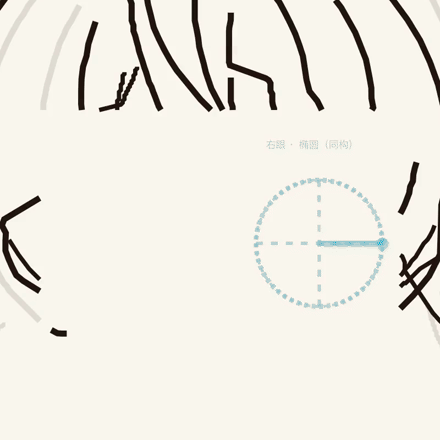

# manim-facepatch-creator — Make facial patches in hand-drawn Manim animations truly invisible

[]()
[]()
[]()

**In one line:** in pencil-tracing + colour-referenced hand-drawn animations, facial features (eyes/mouth) are reproduced as transparent ink patches taken from the pencil source. This package turns those patches from "obviously copy-pasted" into "completely invisible" — and ships the colour-soaking technique and render-sandbox workarounds learned along the way.

<p align="center">
  
  
</p>

*Left: after the eye patch fades in, the bangs inside the cut window are re-traced with the same ink weight as the rest of the drawing (skipping the eyes themselves). Right: colouring — a pale full-image wash first, then region layers deepen one by one.*

## The problem it solves

The face is where hand-drawn animations live or die: mathematical ellipses always look fake, and naive pencil patches betray themselves —

- the patch carries the pencil's **soft graphite hatching**, which reads as a grey rectangle on clean paper;
- pencil hair strands inside the patch are **thinner** than the 2.4-width ink strokes around them, so every seam shows;
- dimming the whole drawing for the close-up leaves the patch **floating alone on paper**;
- colour layers popping in one by one look like stickers, not painting.

Everything here is the end state of four review rounds on the *Yefeng* production; the final cut was approved with **"I literally cannot tell where the patch is."**

## Where this fits

```
manim-handdraw (Python library)      stroke engine: from_image / Stylus / Compass
        ↓                              /cut_out_rectangles /adaptive_widths
manim-handdraw-creator (core skill)  full six-act pipeline: align → trace →
        ↓                              construct → patch → colour → finale
manim-facepatch-creator (this repo)  finishing pass: invisible-patch rules +
                                       re-tracing + soaking colour + sandbox fixes
```

## The five rules (each paid for in review rounds)

1. **Keep only sparse dark strokes in the patch.** Histogram the pencil grays; hatching (gray ≈ 120–200) maps to alpha 0: `light≈155, gamma 1.3` — not the intuitive 205. A good patch has thousands of nonzero pixels, not tens of thousands.
2. **Hug the feature with the window.** Every extra margin cuts more traced strokes and imports more graphite.
3. **Selective spotlight, never global dim.** Strokes within 0.8 Manim units of the focus stay at full opacity; distant ones drop to stroke opacity 0.12.
4. **Re-trace the thin lines.** Extract the dark strokes inside the window (erasing eye ellipses so nothing covers the eyes), then draw them back with the same `adaptive_widths` ink as the rest of the drawing.
5. **Colour must soak, not sticker.** A 32%-alpha full-image wash first, region layers deepening one by one, then the full reference lands as the finale.

## Quick start

```bash
pip install "manim-handdraw[extract]>=0.1.1"
python3 scripts/check_environment.py

# 1) patch (transparent RGBA + placement.json with the exact cut window)
python3 scripts/make_sparse_patch.py --mode patch \
  --pencil pencil_raw.png --output assets/eyes_ink.png \
  --box 630 178 830 300 --scene-height 7.6 --scene-center 0 -0.05

# 2) re-trace source (full-canvas stroke map, eyes erased)
python3 scripts/make_sparse_patch.py --mode retrace \
  --pencil pencil_raw.png --output assets/bangs_source.png \
  --box 630 178 830 300 \
  --erase-ellipse 670 252 46 40 --erase-ellipse 785 255 44 42

# 3) render through the wrapper (sandbox bulk-delete guard workaround)
python3 scripts/render_safe.py -qh my_scene.py MyScene
```

Scene-side snippets and a full parameter reference are in [`examples/yefeng/README.md`](examples/yefeng/README.md).

## The four-round iteration (why each rule exists)

| Round | Feedback | Fix |
| --- | --- | --- |
| v1 | messy lines / wrong background / half-pasted eyes | (starting point) |
| v2 | passable; rectangular patch border; sticker-like colouring | line-art redo, masked colour layers, official window cutting |
| v3 | patch still visible | kill graphite tones + tighter window + **selective spotlight** (the real culprit) |
| v4 | **cannot tell at all** ✅ | **re-tracing** window strokes with matching ink weight |

All 14 battle-tested pitfalls (sandbox bulk-delete guard killing renders in 1s, stale partial-movie caches silently ignoring new assets, out-of-frame end titles, colour layers saved as black silhouettes, …) are catalogued in [`references/pitfalls.md`](references/pitfalls.md).

## Related

- [manim-handdraw](https://github.com/FTZ-OPUS/manim-handdraw) — the stroke engine (bitmap line art → progressive hand-drawn animation)
- [manim-handdraw-creator](https://github.com/FTZ-OPUS/manim-handdraw-creator) — the core full-pipeline skill package
